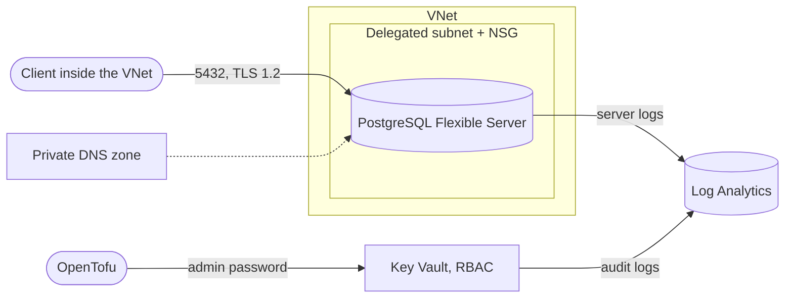

# Azure Managed PostgreSQL (Flexible Server)

A PostgreSQL Flexible Server with private VNet access.

OpenTofu demo template. Standalone, no dependency on other repos. Compatible with Terraform.

Needs **OpenTofu 1.12 or later**, because the admin password uses an ephemeral resource and write-only arguments. OpenTofu 1.11 supports them too, but fails on them in the mocked unit tests.

## Architecture



- Resource group
- VNet with a subnet delegated to PostgreSQL flexible servers and an NSG
- Private DNS zone linked to the VNet
- PostgreSQL Flexible Server with private access (VNet integration)
- Key Vault (RBAC) with the admin password
- Log Analytics workspace with server logs and Key Vault audit logs

## Security

- Public network access disabled, the server is reachable only from inside the VNet
- NSG allows port 5432 only from the VNet and denies all other inbound traffic
- TLS required, minimum TLS 1.2
- Admin password generated per apply as an ephemeral value and written only to write-only arguments. It is never in the state
- Password stored in Key Vault with RBAC, a 1-year expiry date and soft delete
- Automated backups (7 to 35 days)
- Connection logging and connection throttling, server logs and Key Vault audit logs to Log Analytics

Accepted checkov findings (documented inline in the code):

| Check | Reason |
|---|---|
| CKV_AZURE_136 | Geo-redundant backups are out of scope (cost) |
| CKV2_AZURE_57 | VNet integration is used instead of a private endpoint |
| CKV_AZURE_109, CKV_AZURE_189 | OpenTofu writes the secret from outside the VNet, access is controlled by RBAC |
| CKV2_AZURE_32 | Private endpoint for Key Vault is out of scope |
| CKV_AZURE_110, CKV_AZURE_42 | Purge protection would block re-deploying the demo for up to 90 days |

## Usage

Sign in with `az login` and set `ARM_SUBSCRIPTION_ID` to the target subscription.

```bash
cp terraform.tfvars.example terraform.tfvars
tofu init
tofu plan
tofu apply
```

## Access

The server is reachable only from inside the VNet, and the FQDN resolves only there. Clients must run in this VNet. Read the admin password from Key Vault:

```bash
az keyvault secret show --id "$(az keyvault show --ids <key_vault_id> --query properties.vaultUri -o tsv)secrets/postgres-admin-password" --query value -o tsv
```

The identity that runs OpenTofu gets the role "Key Vault Secrets Officer" on the vault. To set a new password, increase `advanced_settings.password_version` and run `tofu apply`.


## Inputs

| Name | Description | Default |
|---|---|---|
| `name_prefix` | Prefix for all resource names | `"demo"` |
| `location` | Azure location | `"germanywestcentral"` |
| `advanced_settings` | Object with the settings below, all optional | `{}` |

`advanced_settings` attributes (shown as "Advanced Settings" in the StackGuardian form):

| Name | Description | Default |
|---|---|---|
| `vnet_cidr` | Address space of the VNet | `"10.0.0.0/16"` |
| `postgres_version` | PostgreSQL major version | `"18"` |
| `sku_name` | SKU of the flexible server | `"B_Standard_B1ms"` |
| `storage_mb` | Storage in MB | `32768` |
| `administrator_login` | Admin user | `"pgadmin"` |
| `password_version` | Increase to set a new admin password | `1` |
| `backup_retention_days` | Days to keep backups (7-35) | `7` |
| `log_retention_days` | Log retention in Log Analytics | `90` |
| `tags` | Additional tags for all resources | `{}` |

## Outputs

| Name | Description |
|---|---|
| `server_fqdn` | FQDN of the server, resolves only inside the VNet |
| `server_name` | Name of the server |
| `administrator_login` | Admin user |
| `key_vault_id` | Key Vault with the admin password |
| `admin_password_secret_name` | Name of the secret |
| `resource_group_name` | Name of the resource group |
| `vnet_id` | VNet ID |

## Cost

The server compute and storage are billed hourly, also when idle. Log Analytics bills ingestion. Creating the server takes about 5 to 10 minutes.

**Destroy after the demo:**

```bash
tofu destroy
```

## Tests

The GitLab pipeline (`.gitlab-ci.yml`) lints every push. Merge requests into `development` or `main` also run
validation, the checkov scan and the unit tests. A tag runs all of these plus the integration tests, which deploy
real resources and destroy them again, and then creates a release. Integration tests run only when the CI/CD variables `AZURE_CLIENT_ID`, `AZURE_TENANT_ID` and `AZURE_SUBSCRIPTION_ID` are set: an app registration with a federated credential for GitLab OIDC and the audience `api://AzureADTokenExchange`.

```bash
tofu test -test-directory=tests/unit
```

Test cases: [tests/README.md](tests/README.md)

## Development

```bash
pre-commit install
pre-commit run --all-files
```
